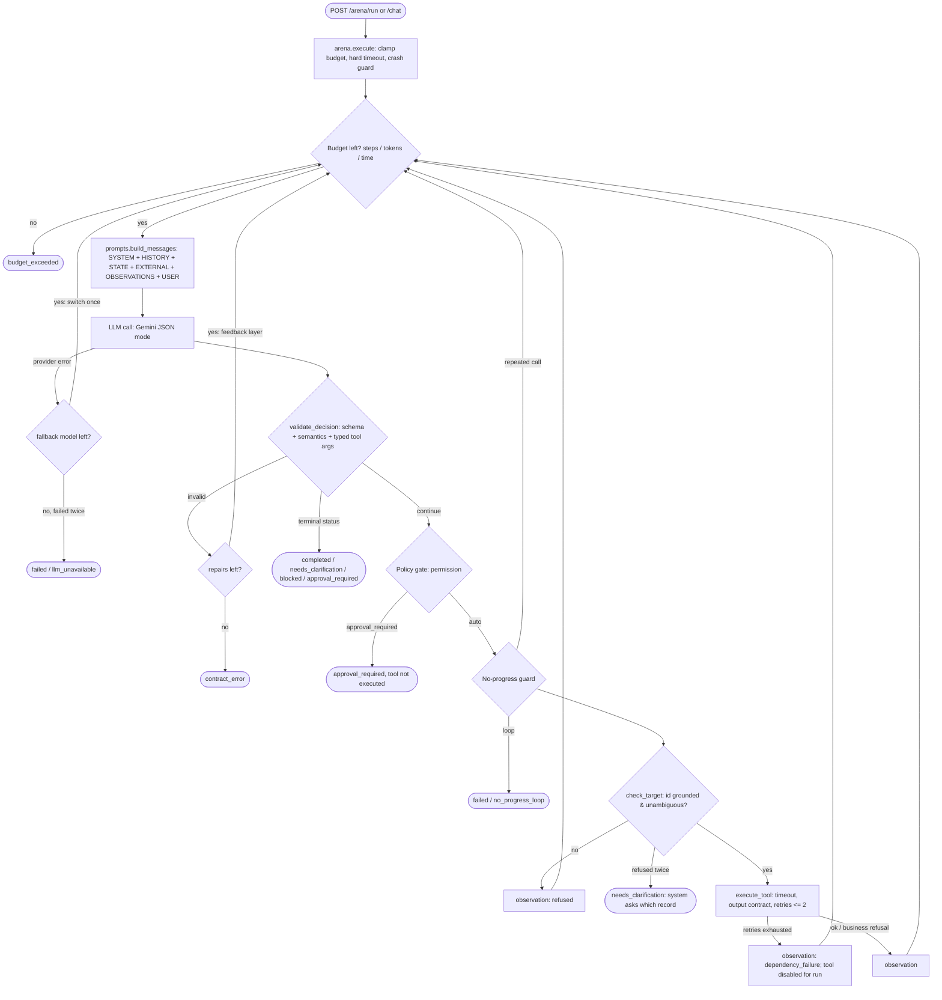

# JobTracker: a bounded job-application tracking agent

JobTracker is a single-agent FastAPI service for the **Agent Arena** (Agentic AI, Fall 2026). It maintains a **sandbox** job-application board. It can search, add, update status (with pipeline rules), detect duplicates, summarise, and draft follow-up emails, which are never sent. It exposes the common Arena interface (`GET /health`, `GET /arena/manifest`, `POST /arena/run`).

The model influences the path. The system owns validation, limits and stopping.

---

## 1. Problem statement

Job seekers track applications across spreadsheets, notes and inboxes. They lose track of stages, forget follow-ups and create duplicate entries. JobTracker turns a natural-language request into **validated operations on a structured board**. When information is missing it asks. Anything consequential (deleting, emailing, submitting) is refused and handed to a human.

**Measurable completion condition:** a run is successful when it ends in one of these ways:

- **completed**: the requested board operation succeeded, as confirmed by a tool observation.
- **needs_clarification**: the request lacks a critical detail, and `missing_fields` names what is missing.
- **approval_required** or **blocked**: the request is consequential or out of scope, and nothing was executed.

All three are machine-readable `status` values with a `stop_reason`.

## 2. Agent Design Canvas

| # | Element | JobTracker |
|---|---|---|
| 1 | Operational goal | Keep a sandbox job-application board correct and up to date from natural-language requests. |
| 2 | Completion condition | The requested operation is confirmed by a successful tool observation. Otherwise a typed stop: clarification, approval, blocked, budget, tool or contract error. |
| 3 | System boundary | In-memory sandbox board seeded from `data/sample_data.json`. There are no external APIs, no real email and no real submissions. Arena runs get a fresh board; each chat session gets its own board. |
| 4 | Observations | User request, bounded chat history, pending goal (from a clarification turn), untrusted external context, board size, and tool results. Record facts reach the model only through tool observations. |
| 5 | Actions / tools | Auto: `search_applications`, `get_summary`, `detect_duplicates`, `add_application`, `update_status`, `draft_follow_up`. Approval-required (never executed): `delete_application`, `send_email`, `submit_application`. |
| 6 | State | Per run (`RunState`): step, model calls, repairs used, tokens, cost, active model, observations, tool traces, errors, events, failed tools, executed-call signatures, grounding refusals. Per session: messages, pending goal, board. |
| 7 | Autonomy boundary | Reading, classifying, summarising and sandbox edits run automatically. Deleting, sending and submitting require approval and stop the run. A follow-up *draft* is the safe downgrade. |
| 8 | Primary risks | Invented ids or details, prompt injection in pasted postings, malformed model output, hung or broken tools, runaway loops, a wrong record updated when several match. |
| 9 | Evaluation criteria | Status correctness on the public cases and Arena categories A–F, no forbidden tool executed, structured-output validity, correct first action, latency, tokens and cost (see §6). |

## 3. Architecture



### Folder structure

```
student-agent/
├── app/
│   ├── main.py        FastAPI app, logging, in-memory session store
│   ├── api.py         /health /arena/manifest /arena/run /models /chat /chat/{id}/board /demo/scenarios
│   ├── arena.py       shared run boundary: budget clamp, hard timeout, crash -> typed failure
│   ├── agent.py       bounded loop, RunState, contract validation, policy gate, stopping rules
│   ├── models.py      Arena contracts, AgentDecision, typed tool args, ToolResult, domain record
│   ├── prompts.py     ChatPromptTemplate, context layers, random-boundary fencing
│   ├── tools.py       sandbox Board, tool registry + permissions, gateway, fault injection
│   ├── memory.py      bounded LangChain message history + pending goal + per-session board
│   ├── config.py      env-driven settings, limits, model list, price table
│   └── static/        demo UI (index.html, app.js, style.css)
├── data/sample_data.json            8 fictional applications (incl. a deliberate duplicate)
├── evaluation/
│   ├── public_cases.json            15 cases covering normal + categories A–F
│   ├── run_public_tests.py          HTTP runner (local or deployed) -> results/public_results_*.json
│   ├── model_comparison.py          model-selection experiment -> results/model_comparison.*
│   ├── run_multiturn_test.py        live two-turn clarification test -> results/multiturn_*.json
│   └── results/                     saved evidence
├── tests/test_agent.py              44 offline tests with a scripted fake model
├── arena_manifest.json  render.yaml  Dockerfile  requirements.txt  .env.example  run.py
├── DEMO.md                          step-by-step demo / walkthrough script
└── SUBMISSION.md
```

## 4. Bounded autonomy

| Allowed automatically | Requires approval (never executed by the agent) | Blocked |
|---|---|---|
| Search, summarise, detect duplicates; add an application; change status along the pipeline; write a follow-up **draft** to the sandbox outbox | `delete_application`, `send_email`, `submit_application`; reopening a final status (`accepted` / `rejected` / `withdrawn`) | Requests outside job tracking (for example "book a flight") or unsafe requests |

Enforcement is done by the **system**. The model's own judgement is not trusted for this.

- Every action has a `permission` in `TOOL_REGISTRY`. If the model names an `approval_required` action, the policy gate records a `rejected` trace and stops with `approval_required`. Restricted tools have no implementation at all.
- Business rules live in the tools: pipeline order, final statuses, unknown ids, duplicate prevention (`allow_duplicate` needs explicit confirmation), dates in the future, URL scheme. These return `ok=false` observations and never mutate the board.
- The safe downgrade for "email the recruiter" is `draft_follow_up`. The agent offers it, and the draft is stored as `draft_not_sent`.

## 5. Structured output, contract and validation

The model must return an `AgentDecision` (`app/models.py`). Gemini is called in JSON mode (`response_mime_type=application/json`). Its reply is still treated as untrusted text until it passes every layer below.

```python
class AgentDecision(BaseModel):          # extra='forbid'
    status: Literal['continue', 'needs_clarification', 'completed',
                    'blocked', 'approval_required', 'failed']
    action: Optional[str]                 # required iff status == 'continue'
    arguments: dict[str, Any]             # must be {} unless continue
    user_message: str                     # required for every terminal status
    missing_fields: list[str]             # required for needs_clarification
    reasoning: str                        # short, logged for observability
```

| Layer | What is checked | Where |
|---|---|---|
| Parsing | Single JSON object (code fences tolerated); non-object JSON is rejected | `agent._extract_json` |
| Schema | Enum values, types, lengths, unknown keys forbidden, status/action/arguments consistency, `missing_fields` for clarification | `AgentDecision` |
| Semantic: decision | `action` exists in the registry; arguments validated against that tool's typed model (`SearchArgs`, `AddArgs`, `UpdateStatusArgs`…, `extra='forbid'`, enum statuses, ISO date not in the future, http(s) URL) | `agent.validate_decision` |
| Semantic: target | For actions on an existing record, the id must be named by the user (task, history, pending goal) or found in this run's observations. Ids found only in untrusted external text do not count. If the latest search that found it matched several records, the call is refused as `ambiguous_target`. A second refusal makes the system ask the user | `agent.check_target` |
| Semantic: state | id exists, pipeline transition allowed, not already in status, duplicate check | tool functions (`transition_error`, …) |
| Tool output | Every tool result must match `ToolResult`, otherwise it is classed as `malformed_output` | `tools.execute_tool` |
| Recovery | Up to `MAX_REPAIR_ATTEMPTS=2` repairs. The validator's error is fed back in a separate `<contract_feedback>` layer, and each repair consumes a step | `agent.run_agent` |
| Typed failure | Repairs exhausted → `contract_error / contract_repair_exhausted`, with nothing executed from the bad output | `agent.run_agent` |

The `invalid_agent_decision` fault replaces the first model reply with one of four corruption types: non-JSON text, wrong enum and types, an inconsistent status and action, or bad tool arguments. The variant is chosen deterministically from the `request_id`, so each one is exercised.

## 6. Model selection experiment

`evaluation/model_comparison.py` runs the **same 15 public cases** (normal tasks plus categories A–F) in-process against each model through the real loop. It records:

- **Task success**: status in the expected set, no forbidden tool executed, no forbidden text.
- **Structured-output validity**: the share of model replies that passed validation, excluding the deliberately injected fault.
- **Action selection**: whether the first successful tool was the expected one.
- **Latency, tokens and approximate cost**.

Raw per-case data is in `evaluation/results/model_comparison.json`.

Results from 2026-11-05: 15 cases per model, model failover disabled, and the system guards on for both models:

| Model | Task success | Structured-output validity | Correct action | Avg latency | Avg calls/run | Avg tokens in/out | Approx. cost/run |
|---|---|---|---|---|---|---|---|
| gemini-3.1-flash-lite | 15/15 | 100.0% | 5/5 | 7101 ms | 1.73 | 2431/176 | $0.00087 |
| gemini-3.5-flash-lite | 15/15 | 100.0% | 5/5 | 9529 ms | 1.73 | 2430/161 | $0.00113 |

Average latency is per *run*, not per call. It includes the deliberate tool-timeout fault (2.5 s) and one provider retry. Cost uses the approximate prices in `MODEL_PRICES`.

**Other models probed with the same agent:**

| Model | Finding |
|---|---|
| gemini-2.5-flash | Correct in early smoke runs (4/4 cases), but the free tier allows **20 requests per day per model** (`GenerateRequestsPerDayPerProjectPerModel-FreeTier`, quota_value 20). One agent run uses 2–3 calls, so the quota ran out within minutes and later runs ended in `failed / llm_unavailable`. That makes it unusable as the default for a public Arena endpoint. It is kept as the last failover. |
| gemini-3.5-flash, gemini-3.8-flash | Thinking models. Hidden reasoning used up the 768-token output budget (one reply was truncated, invalid JSON) and calls hit the 15 s timeout (504). Too slow for a 6-step, 40 s budget. |
| gemini-3.5-flash-lite (without the target-grounding guard) | On "Move my Google software engineer application to interviewed" it **guessed** app-001 instead of asking. gemini-3.1-flash-lite asked correctly. This finding is why `check_target` was added: with the guard, both models pass the ambiguity cases. |

**Selection: `gemini-3.1-flash-lite` (default)**, with failover to `gemini-3.5-flash-lite` and then `gemini-2.5-flash`. The reasons:

- It ties on reliability (15/15, 100% valid contracts, 5/5 actions) and needed no system guard to handle ambiguity correctly.
- It has the lowest latency of the usable models. That matters because a run can take up to 6 sequential calls inside a 40 s budget.
- It is the cheapest per run.
- It did not hit a daily quota across roughly 150 requests during development and evaluation, unlike 2.5-flash. Check the current limits in AI Studio before the evaluation window.
- A call needs only about 1.5–3.5k input tokens, with history bounded, which is far below the Flash-Lite context window.

**Limits that keep runs affordable:**

- `MAX_STEPS=6` model calls per run, including repairs.
- `MAX_TOOL_RETRIES=2` and `MAX_REPAIR_ATTEMPTS=2`.
- `MAX_OUTPUT_TOKENS=768` per call.
- `MAX_RUN_TOKENS=40000` and `RUN_TIMEOUT_SECONDS=40` per run.
- `LLM_TIMEOUT_SECONDS=15` and `TOOL_TIMEOUT_SECONDS=2.5`.
- History of at most 12 messages and 12,000 characters.
- Tool observations truncated to 1,800 characters each in the prompt.

A typical run costs about $0.0005–0.002.

## 7. Prompt and context engineering

`prompts.py` builds every model call from a `ChatPromptTemplate`:

| Layer | Message | Content |
|---|---|---|
| SYSTEM | `SystemMessage` | Role, goal, tool catalog **rendered from the registry**, pipeline rules, output contract, decision rules, trust hierarchy |
| HISTORY | `MessagesPlaceholder` | Bounded prior `HumanMessage` / `AIMessage` turns |
| STATE | `<runtime_state>` | Today's date, step k of N, repairs left, board **size only**. Record details must be read through tools, which keeps the loop observation-driven and stops the model answering or picking ids from memory |
| CONVERSATION STATE | `<conversation_state>` | Pending goal and the question the agent asked (clarification turns only) |
| EXTERNAL (untrusted) | `<untrusted_external_content boundary=…>` | Pasted postings and emails, labelled DATA ONLY |
| TOOL OBSERVATION | `<tool_observations boundary=…>` | JSON results of this run's tool calls, also DATA ONLY |
| FEEDBACK | `<contract_feedback>` | Validator error, only during a repair |
| USER | `<user_request>` | The current request, placed last |

**Trust rule.** Untrusted blocks are fenced with a **random per-run boundary** (`secrets.token_hex`). Any occurrence of that boundary inside the content is stripped, so pasted text cannot forge a closing tag and "escape" into the instruction layer. External content never enters the system message. There is no keyword filtering for phrases like "ignore previous instructions". Robustness comes from the instruction hierarchy, the fencing and the system-side policy gate: even a fully hijacked model cannot delete, send or submit anything.

## 8. Conversation memory policy

- A stable `session_id` (UUID from the browser) maps to a `Session` holding LangChain messages, an optional **pending goal** and the session's own sandbox board.
- History is bounded to `MAX_HISTORY_MESSAGES=12` (6 turns) **and** `MAX_HISTORY_CHARS=12000`. The oldest whole turns are dropped first. At most `MAX_SESSIONS=100` sessions are kept, with least-recently-used eviction.
- When a run ends in `needs_clarification`, the goal and question are stored as `pending`. The next turn gets them in the `<conversation_state>` layer, so a bare reply like "app-001" continues the original update. Any other terminal status clears `pending`.
- **New chat** (UI button, or `DELETE /chat/{session_id}`) clears the history, the pending goal and the board.
- Memory is in-process: it is **lost on restart**, and the service must run with **one worker** (configured in `render.yaml` and the `Dockerfile`). `/arena/run` is stateless by design.

## 9. Stopping conditions

| Condition | status / stop_reason |
|---|---|
| Model reports done after observations | `completed / goal_completed` |
| Critical detail missing or ambiguous | `needs_clarification / clarification_required` |
| Consequential action requested or proposed | `approval_required / approval_required` |
| Out of scope or unsafe | `blocked / out_of_scope_or_unsafe` |
| Step budget (`max_steps`, ≤ 6; every model call, including repairs, counts) | `budget_exceeded / step_budget_reached` |
| Token budget (`MAX_RUN_TOKENS`) | `budget_exceeded / token_budget_reached` |
| Wall-clock budget (`RUN_TIMEOUT_SECONDS=40`, checked before each call, plus a hard `asyncio.timeout`) | `budget_exceeded / time_budget_reached` |
| Tool failed after retries and the model cannot recover (or claims success anyway) | `tool_error / tool_retries_exhausted` |
| Contract repairs exhausted | `contract_error / contract_repair_exhausted` |
| Identical call repeated without progress | `failed / no_progress_loop` |
| Model provider failed (after one automatic failover to the next configured model) | `failed / llm_unavailable` |
| Unexpected exception | `failed / internal_error` (never an HTTP 500) |

Budget stops return a readable summary of what was completed. They never return raw JSON.

## 10. Reliability Arena mapping

| Category | Mechanism |
|---|---|
| A Ambiguity | Contract requires `missing_fields`. Decision rules forbid invented ids and details. The system-side `check_target` refuses ungrounded or ambiguous targets and asks the user itself. Tools refuse unknown ids, and duplicate adds need confirmation. |
| B Injection | Random-boundary fencing, layer separation, trust hierarchy in the system policy, and a system-side policy gate independent of the model. |
| C Invalid contract | Schema, semantic and typed-argument validation; bounded repair with feedback; typed `contract_error`. |
| D Tool failure | Per-call `asyncio.wait_for` timeout, output contract validation, ≤ 2 retries with backoff, the tool disabled for the rest of the run, and a no-false-success rule. The model provider is a dependency too: rate limits and outages trigger one failover to the next configured model. |
| E Budget | Step, token and time budgets checked before every model call; hard timeout; partial-progress summary. |
| F Autonomy | Permission per tool; restricted tools have no implementation; draft downgrade. |

## 11. Observability

Every run emits structured events (`run_start`, `llm_reply` with model, latency and tokens, `llm_error`, `model_fallback`, `fault_injected`, `validation` pass/fail with detail, `decision`, `policy_gate`, `observation`, `stop`). These are logged as JSON lines and returned in `events`. `tool_calls` holds one trace per attempt (`success` / `timeout` / `malformed_output` / `exception` / `rejected`). `errors` holds typed error entries. `metrics` holds latency, model calls, tokens and estimated cost. API keys are never logged.

## 12. Run locally

```bash
python -m venv .venv
.venv\Scripts\activate          # Windows   (source .venv/bin/activate on macOS/Linux)
pip install -r requirements.txt
copy .env.example .env          # then set GEMINI_API_KEY in .env
python run.py                   # http://127.0.0.1:8000  (UI at /, docs at /docs)
```

Environment variables: `MODEL_PROVIDER`, `MODEL_NAME`, `AVAILABLE_MODELS` (UI choices and failover order), `MODEL_FALLBACK`, `GEMINI_API_KEY`, `MAX_STEPS`, `MAX_TOOL_RETRIES`, `MAX_REPAIR_ATTEMPTS`, `MAX_OUTPUT_TOKENS`, `MAX_RUN_TOKENS`, `RUN_TIMEOUT_SECONDS`, `LLM_TIMEOUT_SECONDS`, `TOOL_TIMEOUT_SECONDS`, `MAX_HISTORY_MESSAGES`, `MAX_HISTORY_CHARS`, `MAX_SESSIONS`, `MODEL_PRICES`, `LOG_LEVEL`, `HOST`, `PORT`.

### Tests and evaluation

```bash
python -m unittest discover -s tests -v                       # offline, free, no key needed
python evaluation/run_public_tests.py --url http://127.0.0.1:8000 --label local
python -m evaluation.run_multiturn_test                        # live 2-turn clarification
python -m evaluation.model_comparison --models gemini-3.1-flash-lite,gemini-3.5-flash-lite
```

The offline suite drives the real loop, validator, gateway and API with a scripted fake model. It covers every Arena category, multi-turn memory, target grounding, model failover, budgets, isolation and the domain rules.

The demo UI (`/`) has a **Demo scenario** picker (served from `GET /demo/scenarios`), fault and step-budget controls, and a toggle to send a run to the stateless `/arena/run`. See [DEMO.md](DEMO.md) for a full walkthrough.

Example Arena call:

```bash
curl -X POST https://YOUR-APP.onrender.com/arena/run -H "Content-Type: application/json" \
  -d '{"task":"Give me a summary of my board","external_context":[],"arena_config":{"max_steps":6,"fault":"none"}}'
```

## 13. Deploy on Render

1. Push the repository to GitHub, then in Render choose **New → Blueprint** (uses `render.yaml`) or **Web Service**.
2. Build: `pip install -r requirements.txt`. Start: `uvicorn app.main:app --host 0.0.0.0 --port $PORT --workers 1`.
3. Set `GEMINI_API_KEY` as a secret environment variable. The other variables have defaults in `render.yaml`.
4. Verify: `GET /health`, `GET /arena/manifest`, and `POST /arena/run` via `/docs`. Then run `python evaluation/run_public_tests.py --url https://YOUR-APP.onrender.com --label deployed`.

## 14. Limitations

- Memory and session boards are in-process. They reset on restart or redeploy, and a free Render instance sleeps after inactivity (the first request after sleep has a cold start of about 50 s). The service must run with a single worker.
- The board is a sandbox seeded from fictional data. There is no persistence and no real integrations. Approval-required actions are refused, not queued for later approval.
- Ambiguity and injection handling still depend partly on the model's judgement. The system guarantees only that nothing consequential executes and that every stop is typed.
- Token counts and cost come from provider usage metadata and the approximate price table in `MODEL_PRICES`, so treat them as estimates.
- The public cases are a small sample. They are not the hidden Arena score.
